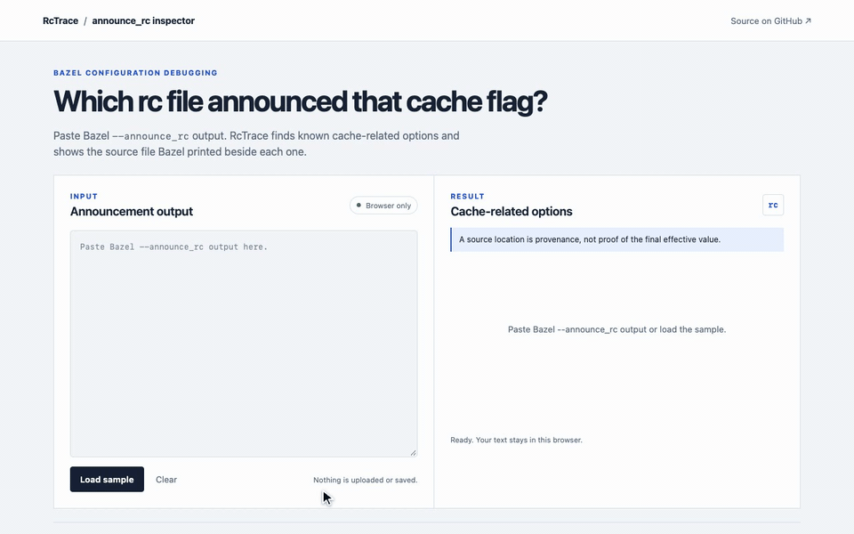

# RcTrace

See which rc file Bazel announced for cache-related options. RcTrace runs in your browser and keeps pasted output on your device.



## Try it locally

Run the local page, click **Load sample**, then paste your own `--announce_rc` output into the editor.

The sample is captured from Bazel 9.3.1 building a minimal `filegroup`. Bazel reported an `--action_env` change that discarded its analysis cache. The target had no actions to build, so this does not demonstrate a remote-cache hit or miss.

## What it shows

- Recognized `--remote_cache`, `--disk_cache`, `--repository_cache`, and cache behavior options.
- The command scope and source path Bazel printed for each occurrence.
- Action-configuration options that may change configured actions or action keys, grouped separately from cache settings.
- A short explanation for each recognized option, linked to Bazel documentation.

RcTrace does not calculate the final effective value. `--announce_rc` reports options read from rc files. It does not by itself resolve command-line overrides, config expansion, or later precedence. RcTrace also does not diagnose cache misses.

The EngFlow [Bazel Invocation Analyzer](https://docs.engflow.com/bia/how_to_use/github_repo.html) analyzes Bazel profiles and suggests performance improvements. RcTrace works from pasted rc announcement output and answers the narrower provenance question.

## Run locally

Requires Node.js 22 or later.

```sh
git clone https://github.com/dallascrilley/rctrace.git
cd rctrace
npm ci
npm run dev
```

Then open <http://localhost:8787>. To analyze a real capture, run a Bazel command with `--announce_rc` and paste its output. RcTrace needs no Bazel installation.

## Development

```sh
npm ci
npm test
npx playwright install ffmpeg
npm run demo
npm run verify
```

The browser checks need Chrome. Playwright and the GIF recorder are development tools; the static page has no runtime dependencies. `npm run verify` checks the parser, the browser flow, local-only processing, and that the recorded GIF is shorter than 10 seconds.

## Privacy and limits

The app processes pasted text in browser memory. It does not upload, store, or send the pasted text anywhere. The page requests its own static files and the sample contains no personal data. Source paths or option values may contain private details, so review them before sharing a screenshot.

The option catalog is intentionally small. Unknown Bazel options are ignored. Explanations describe a flag's documented role, not whether it changes a particular target's action key. The app does not parse `.bazelrc` files, inspect a build, or infer the final option value.

## License

MIT. See [LICENSE](LICENSE).
